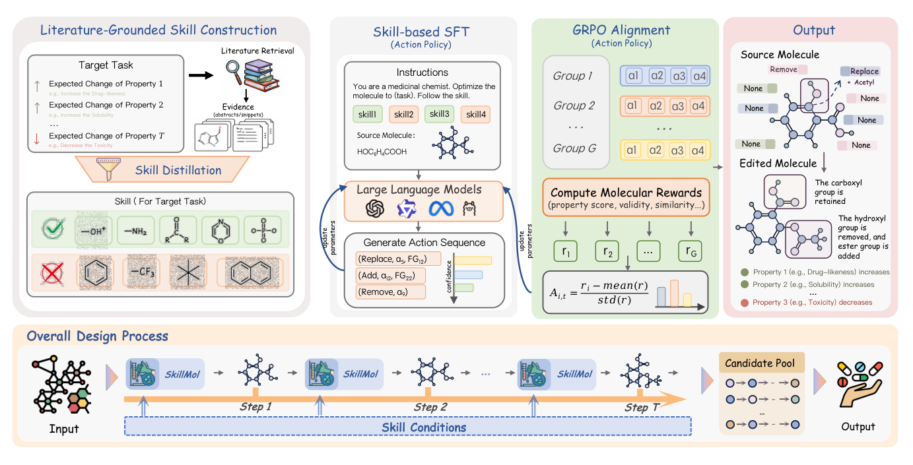
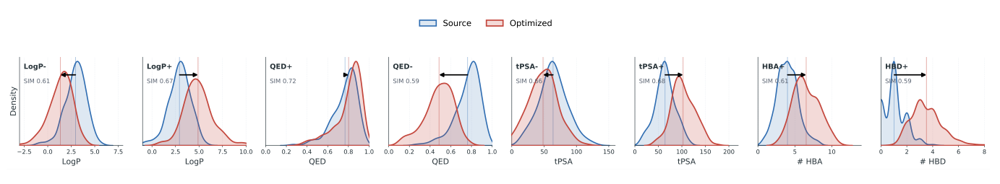
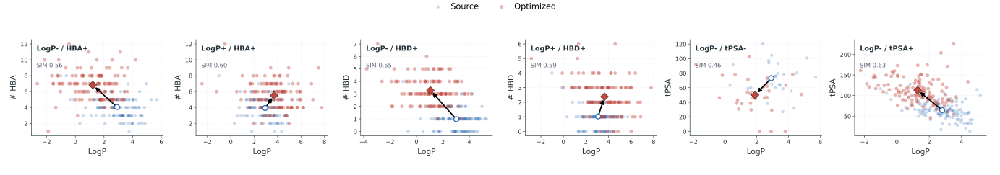
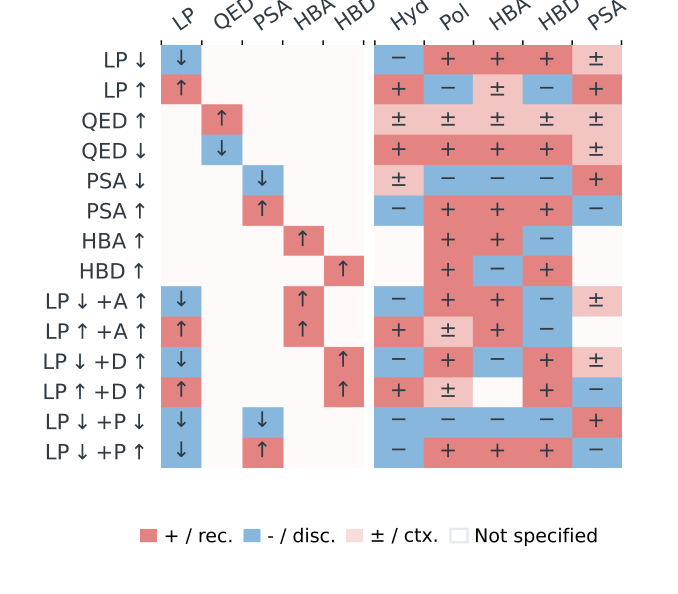
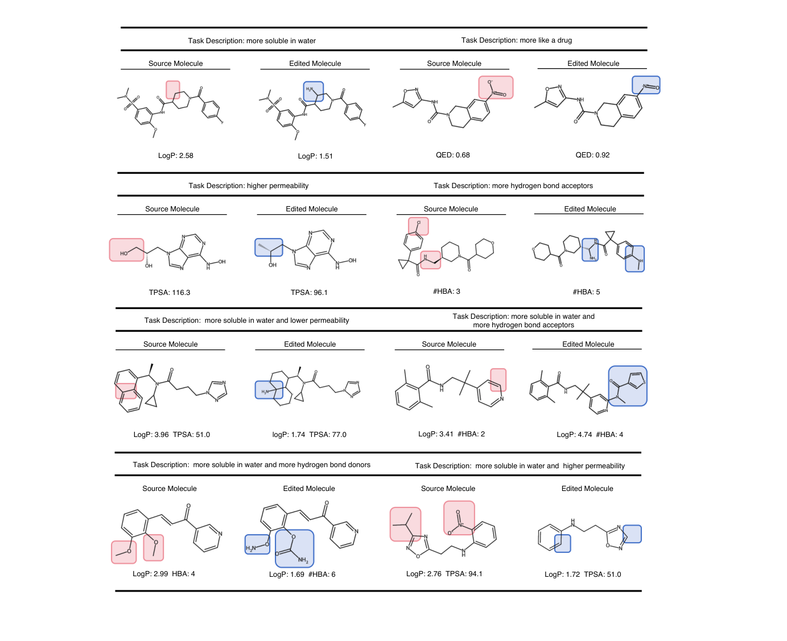

<div align="center">


# SkillMol

### Skill-Conditioned Action Editing for Molecular Optimization

**Turn reusable chemical knowledge into executable molecular edits.**

[](https://aclanthology.org/2026.findings-emnlp.920/)
[](https://aclanthology.org/2026.findings-emnlp.920/)
[](#quick-start)

Jiajun Yu, Kun Li, Zhihao Wu, Weifan Mao, Yizhen Zheng, and Haishuai Wang

[Highlights](#highlights) · [Method](#method) · [Results](#results) · [Quick start](#quick-start) · [Citation](#citation)

</div>

---

SkillMol supplies molecular editing models with **task-level chemical skills**: reusable guidance about which structural motifs to favor or avoid for a property objective. A language model predicts atom-anchored edit actions, a deterministic RDKit executor applies them, and skill-guided search ranks the resulting candidates.

## Highlights

- **Chemical knowledge before molecule-specific editing.** Compact task skills encode recommended and discouraged functional groups.
- **Skills used twice.** They condition action learning during training and guide functional-group constraints during inference search.
- **Executable, inspectable actions.** Atom-anchored operations make proposed changes explicit and support deterministic graph execution.
- **Strong results across 14 editing tasks.** The paper reports **92.5% loose** and **80.0% strict** average single-property hit ratios, plus **65.3%** averaged over multi-property loose and strict columns.

## Method

<p align="center">
  
</p>

*Figure 2 from the paper.* Task skills connect domain knowledge to action learning and inference. The model proposes discrete edits, the executor modifies the molecule, and property rewards rank candidates.

## Results

| Evaluation setting | SkillMol | Paper reference |
| :--- | ---: | :--- |
| Single-property · loose average hit ratio | **92.5%** | Table 1 |
| Single-property · strict average hit ratio | **80.0%** | Table 2 |
| Multi-property · average over loose and strict columns | **65.3%** | Table 3 |

Results are from the paper's MoleculeSTM benchmark evaluation. Loose hits require the requested direction; strict hits must also exceed the specified improvement thresholds. These figures describe the paper's trained system, not an unadapted base-model run.

<p align="center">
  
</p>

*Figure 4.* Before-and-after property distributions show how the learned edits move molecules toward the requested objectives.

<details>
<summary><b>See multi-property optimization, skill alignment, and editing trajectories</b></summary>



*Figure 5.* Source and optimized molecules under paired property objectives.



*Figure 6.* Alignment between task skills and the model's optimization behavior.



*Figure 8.* Source molecules, predicted actions, and the resulting molecular transformations.

</details>

## Quick start

### 1. Install dependencies

```bash
pip install -r requirements.txt
conda install -c conda-forge rdkit
```

Use a PyTorch build matching your CUDA version for GPU training or inference.

### 2. Prepare model weights

This release includes code, task skills, a functional-group vocabulary, and test data. **Model weights, trained adapters, and training datasets are not bundled.** Supply your trained adapter for evaluation; the base model alone does not reproduce the paper's results.

### 3. Evaluate molecular editing

Run from the repository root, replacing `path/to/adapter` with your checkpoint:

```bash
PYTHONPATH=. python 05_infer_rerank/eval_chatdrug_14tasks_unified.py \
  --model_path Qwen/Qwen3-0.6B \
  --adapter_dir path/to/adapter \
  --test_csv data/test_chatdrug.csv \
  --output_dir outputs/eval_14tasks \
  --max_rows 200 \
  --n_samples 8 \
  --search_width 8 \
  --search_depth 1 \
  --extra_prompt_path skill.md \
  --no_mol_tokens
```

### 4. Train with skill-conditioned supervision

Provide prepared training and validation JSONL files:

```bash
PYTHONPATH=. python 03_sft/train_sft.py \
  --model_name Qwen/Qwen3-0.6B \
  --train_jsonl path/to/train.jsonl \
  --val_jsonl path/to/val.jsonl \
  --output_dir outputs/skillmol_sft \
  --config_json configs/sft_clean_full_nomoltok_skillprompt_3epoch_live.json
```

## Repository guide

| Path | Purpose |
| :--- | :--- |
| [`skill.md`](skill.md) | Reusable task-specific chemical skills |
| [`onerec_mol/`](onerec_mol/) | Prompts, graph edits, rewards, training, and inference |
| [`03_sft/`](03_sft/) | Supervised fine-tuning entry points |
| [`04_grpo/`](04_grpo/) | Reinforcement learning entry points |
| [`05_infer_rerank/`](05_infer_rerank/) | Editing evaluation and candidate ranking |
| [`configs/`](configs/) | Representative training configurations |
| [`data/`](data/) | Test molecules and functional-group vocabulary |
| [`assets/figures/`](assets/figures/) | Figures reproduced from the paper |

## Citation

```bibtex
@inproceedings{yu2026skillmol,
  title     = {{SkillMol}: Skill-Conditioned Action Editing for Molecular Optimization},
  author    = {Yu, Jiajun and Li, Kun and Wu, Zhihao and Mao, Weifan and Zheng, Yizhen and Wang, Haishuai},
  booktitle = {Findings of the Association for Computational Linguistics: EMNLP 2026},
  year      = {2026},
  pages     = {19428--19445},
  url       = {https://aclanthology.org/2026.findings-emnlp.920/}
}
```
